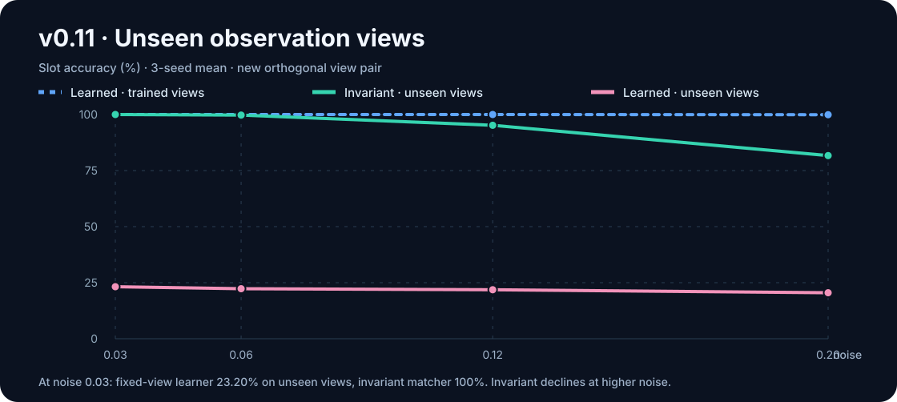
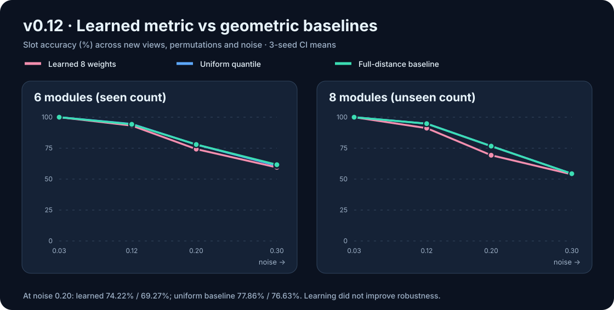
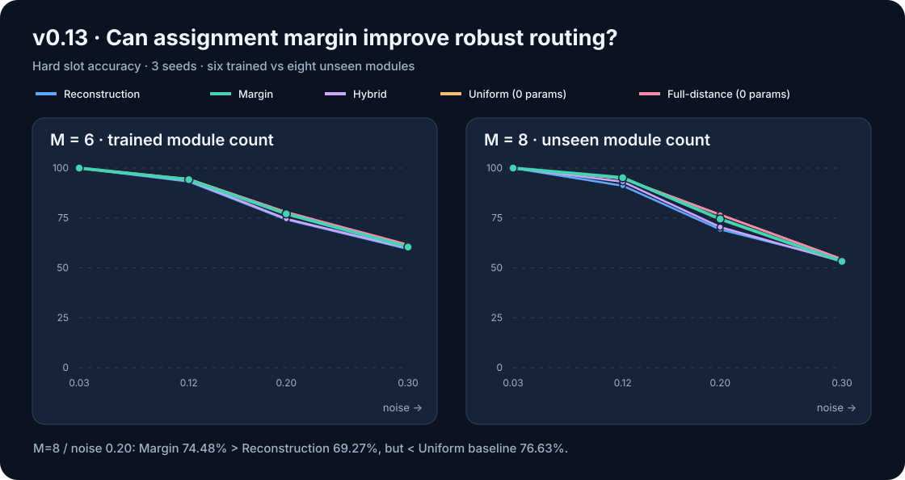
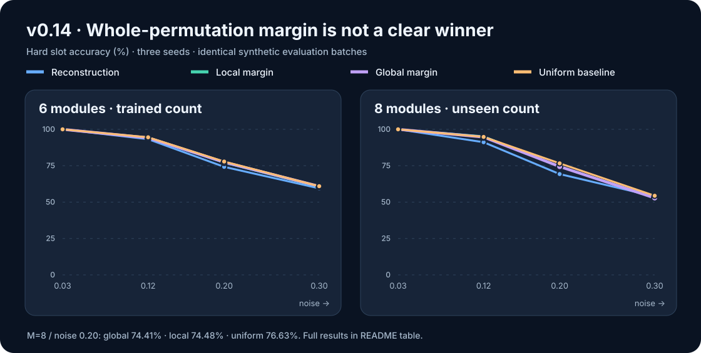

# FlowCore

[](https://github.com/ZJY-HSBL/Flowcore/actions/workflows/ci.yml)


**Composable discrete dynamics · Parallel prefix scan · Dynamic routing**

FlowCore is an experimental PyTorch research library for persistent-state
neural computation. It represents time evolution as structured, associative
transition operators, then evaluates them with a work-efficient parallel scan.
Route, Hold and multi-port injection provide configurable dynamic behavior.


> **Research status — v0.15.0.** The figures below are *real recorded CI reference
> measurements on synthetic tasks*, not fabricated projections. They do not
> establish AGI capabilities, generic sequence-model superiority, GPU speedups,
> or effectiveness on natural-language/vision tasks.

## The mathematical idea

For affine dynamics:

```text
h[t+1] = A[t] h[t] + b[t]

(A2, b2) ∘ (A1, b1) = (A2 A1, A2 b1 + b2)
```

Operator composition is associative. FlowCore implements a work-efficient
Blelloch scan with **O(T) operator compositions** and **O(log T) dependency
depth**. This is an algorithmic property, **not** an unconditional throughput
claim: operator composition can be more expensive than serial matvecs.

The project tests four substrate families: block-local affine, spectral-
Kronecker, circulant/FFT-Kronecker, and monomial permutation × gain. The first
three are selectable via `FlowCoreModel`; the monomial family is currently an
independent exact-scan primitive used with discrete controllers.

## Experiments and measured results

The charts use data from [`results/ci_reference_summary.json`](results/ci_reference_summary.json).
**Each version has a different controlled protocol**, so cross-version figures
must not be treated as a single matched leaderboard. Full protocols, limitations,
and links to the original CI runs are in [Experiment results](docs/RESULTS.md).

### v0.5 — Can information move between physical modules?


| Backend | Target-module energy | Long-horizon target MSE |
| :-- | --: | --: |
| Block-local | 0.00% | 0.97018 |
| Spectral-Kronecker | 12.56% | 0.55690 |
| **Circulant-Kronecker** | **99.88%** | **0.00320** |

Three seeds, 4 modules, 1D local state, fixed input source and trainable destination
Route policy with frozen substrate; [CI run and artifact](https://github.com/ZJY-HSBL/Flowcore/actions/runs/37742036277).
Circulant performs well on this *translation-aligned* task.

### v0.6 — Where does circulant routing fail?


| Backend | Cyclic slot accuracy | Arbitrary slot accuracy |
| :-- | --: | --: |
| Block-local | 16.62% | 23.18% |
| Spectral-Kronecker | 16.60% | 18.45% |
| **Circulant-Kronecker** | **99.09%** | **27.47%** |

Three seeds, 6 modules, 2D local state, simultaneous multi-source payloads;
[CI run](https://github.com/ZJY-HSBL/Flowcore/actions/runs/37797719671).
The **0.81384** normalized analytic projection error on the arbitrary family
shows a *representation limitation*, not only a training failure.

### v0.7–v0.9 — Exact arbitrary routing and controller compression

v0.7 added an associative **monomial operator** (one-to-one permutation × gain):
the supplied-permutation oracle achieved **zero MSE**, **100% slot accuracy**
and **zero parallel/sequential error**
([v0.7 CI](https://github.com/ZJY-HSBL/Flowcore/actions/runs/37798579002)).
v0.8 then learned all four fixed arbitrary permutations through Sinkhorn
relaxation and hard assignment from payload reconstruction loss
([v0.8 CI](https://github.com/ZJY-HSBL/Flowcore/actions/runs/37799900510)).


| Controller | Parameters | Hard whole-task exact |
| :-- | --: | --: |
| Rank 1 | **30** | **100%** |
| Rank 2 | 60 | 100% |
| Rank 3 | 90 | 100% |
| Rank 4 | 120 | 100% |
| v0.8 full task table | 144 | 100% |

v0.9: three seeds, four **fixed** 6-module tasks; [CI rank sweep](https://github.com/ZJY-HSBL/Flowcore/actions/runs/37800868426).
The 30-parameter result establishes compression **on this task bank only**; it
does not mean rank 1 can encode every possible permutation family.

### v0.10 — Learn routing from content, without task IDs


Each training/evaluation batch regenerates source descriptors and random
permutations. A shared **72-parameter** matching controller learns to align
source and target descriptors observed through two fixed but different views.

| v0.10 metric | Seed 0 | Seed 1 | Seed 2 | Mean |
| :-- | --: | --: | --: | --: |
| Soft Sinkhorn MSE | 0.001702 | 0.002464 | 0.001807 | **0.001991** |
| Hard execution MSE | 0 | 0 | 0 | **0** |
| Unseen permutation exact | 100% | 100% | 100% | **100%** |
| 2× noise slot accuracy | 100% | 100% | 100% | **100%** |
| Parallel/sequential error | 0 | 0 | 0 | **0** |

3 seeds, 6 modules, 3D payloads, 450 updates, context noise 0.03 (2× = 0.06),
512 evaluation samples per seed; [v0.10 CI + JSON artifact](https://github.com/ZJY-HSBL/Flowcore/actions/runs/37801859799).
All **39 tests passed** on Python 3.10, 3.11 and 3.12. These measurements
demonstrate *synthetic content-conditioned matching*, not novel semantic
reasoning. The two views remain fixed within each training run.

## Installation and quick start

```bash
git clone https://github.com/ZJY-HSBL/Flowcore.git
cd Flowcore
python -m pip install -e ".[dev]"
pytest -q
python examples/toy_delayed_copy.py
```

```python
import torch
from flowcore import FlowConfig, FlowCoreModel

config = FlowConfig(
    input_dim=16, output_dim=4,
    state_dim=256, block_size=8,
    num_ports=8, active_ports=2, context_dim=32,
    substrate_kind="circulant_kronecker",  # or "block", "spectral_kronecker"
)
model = FlowCoreModel(config)

x = torch.randn(8, 128, 16)
context = torch.randn(8, 32)
parallel = model(x, context=context, mode="parallel")
sequential = model(x, context=context, mode="sequential")
print(parallel.output.shape)                          # (8, 128, 4)
print((parallel.states - sequential.states).abs().max().item())
```

## Reproduce the figures

The curated CI data are checked into
[`results/ci_reference_summary.json`](results/ci_reference_summary.json).
These are **recorded reference numbers**, not a substitution for running the
experiments yourself. Representative commands:

```bash
python experiments/compare_substrates.py --steps 120 --seeds 0,1,2 --modules 4 --local-dim 1 --train-time 4 --long-time 16
python experiments/arbitrary_routing_stress.py --steps 100 --seeds 0,1,2 --modules 6 --local-dim 2 --tasks 4 --long-time 16
python experiments/factorized_controller_sweep.py --steps 300 --seeds 0,1,2 --ranks 1,2,3,4
python experiments/context_route_generalization.py --steps 450 --seeds 0,1,2 --modules 6 --context-dim 6 --rank 6
```

For **exact CI command flags** (including batch sizes, evaluation settings and
output paths), see [`docs/RESULTS.md`](docs/RESULTS.md) and
[`.github/workflows/ci.yml`](.github/workflows/ci.yml).

## v0.11 — The unseen-view generalization boundary



| Noise | Learned, trained views | Learned, **new views** | Invariant matcher, **new views** |
| ---: | ---: | ---: | ---: |
| 0.03 | 100.00% | 23.20% | **100.00%** |
| 0.06 | 100.00% | 22.31% | **99.74%** |
| 0.12 | 100.00% | 21.85% | **95.20%** |
| 0.20 | 99.91% | 20.51% | **81.68%** |

In a different, previously unseen orthogonal observation-view pair, the
v0.10 learned controller drops sharply. The zero-parameter baseline uses
**sorted within-set distance fingerprints**, which are invariant to shared
orthogonal transforms; it remains accurate at low noise but degrades as noise
rises. This baseline relies on having two observations of the *same complete
point set* and is **not a learned general-purpose semantic router**.

Three seeds, 6 modules, 400 training steps, synthetic Gaussian addresses;
[v0.11 CI and raw artifact](https://github.com/ZJY-HSBL/Flowcore/actions/runs/39002837720).
**44 tests passed** across Python 3.10/3.11/3.12.

```bash
python experiments/unseen_view_stress.py --steps 400 --seeds 0,1,2
```

See [v0.11 report](docs/V0_11_REPORT.md) and [measurement protocol](docs/RESULTS.md).

## v0.12 — Learned geometric metric: a useful negative result



| Module count | Noise | Learned (8 params) | Uniform (0 params) | Full-distance (0 params) |
| ---: | ---: | ---: | ---: | ---: |
| 6 (trained size) | 0.03 | **100.00%** | **100.00%** | **100.00%** |
| 6 | 0.12 | 93.23% | **94.53%** | 94.27% |
| 6 | 0.20 | 74.22% | 77.86% | **77.95%** |
| 6 | 0.30 | 59.46% | 60.94% | **61.63%** |
| 8 (**held-out size**) | 0.03 | **100.00%** | **100.00%** | **100.00%** |
| 8 | 0.12 | 91.15% | **94.79%** | **94.79%** |
| 8 | 0.20 | 69.27% | **76.63%** | **76.63%** |
| 8 | 0.30 | 53.84% | **54.36%** | **54.36%** |

**Finding:** A structurally invariant representation supports new independent
orthogonal views and an unseen module count, but learning eight metric weights
from soft payload-reconstruction loss **reduced high-noise accuracy** in this
experiment. The metric did **not** outperform the two zero-parameter baselines.
The comparison is stronger than only reporting low-noise 100% accuracy.

Three seeds, 350 updates per seed, fresh independently transformed descriptors
in each batch, train modules=6, eval modules=6/8. [v0.12 CI results and raw
JSON artifact](https://github.com/ZJY-HSBL/Flowcore/actions/runs/39017452897).
**48 tests passed** on Python 3.10/3.11/3.12.

```bash
python experiments/structural_metric_stress.py --steps 350 --seeds 0,1,2
```

See [v0.12 report](docs/V0_12_REPORT.md) and [full result provenance](docs/RESULTS.md).

## v0.13 — Assignment-margin loss versus reconstruction



All three learned methods share the same **eight metric parameters**, fixed
optimization budget, initialization, training batches and evaluation examples.
The only intervention is the objective: reconstruction, bidirectional matching
margin, or a 1:1 combination. Two independent **zero-parameter geometric
baselines** are evaluated alongside them.

| Modules | Noise | Reconstruction | Margin | Hybrid | Uniform (0p) | Full distance (0p) |
| ---: | ---: | ---: | ---: | ---: | ---: | ---: |
| 6 | 0.03 | 100.00% | 100.00% | 100.00% | 100.00% | 100.00% |
| 6 | 0.12 | 93.23% | 94.18% | 93.75% | 94.53% | 94.27% |
| 6 | 0.20 | 74.22% | 77.08% | 74.57% | 77.86% | 77.95% |
| 6 | 0.30 | 59.46% | 60.42% | 59.81% | 60.94% | 61.63% |
| 8 | 0.03 | 100.00% | 100.00% | 100.00% | 100.00% | 100.00% |
| 8 | 0.12 | 91.15% | 95.18% | 93.16% | 94.79% | 94.79% |
| 8 | 0.20 | 69.27% | 74.48% | 70.44% | 76.63% | 76.63% |
| 8 | 0.30 | 53.84% | 53.26% | 53.19% | 54.36% | 54.36% |

*Hard slot accuracy (%), three-seed means.*

**Result:** Margin improves upon reconstruction in several moderate-noise
settings, but **does not consistently beat the analytical baselines**. At unseen
M=8 and noise 0.20, Margin rises from 69.27% to 74.48% (+5.21 points)
while remaining below the zero-parameter 76.63% (-2.15 points). At M=8,
noise 0.12 it narrowly leads 95.18% versus 94.79% (+0.39 points); three
seeds and multiple tested conditions do not establish that as significant.

**Supervision caveat:** The margin objective recovers exact correspondence
indices from the *same input/target payload pairs* available to reconstruction.
No extra dataset is used, but this is **more direct assignment supervision**.

[Completed v0.13 CI run and per-seed JSON artifact](https://github.com/ZJY-HSBL/Flowcore/actions/runs/39018232214);
**52 tests passed** across Python 3.10/3.11/3.12.

```bash
python experiments/route_loss_comparison.py --steps 350 --seeds 0,1,2
```

See [v0.14 report](docs/V0_14_REPORT.md) and
[measurement provenance](docs/RESULTS.md).

## v0.14 — Global structured assignment loss



v0.14 compares **whole-permutation margin** against the local margin from
v0.13, using the same **eight-parameter invariant metric**, learning data,
random seeds, optimization budget and evaluation batches. The global loss
scores every complete permutation and enforces a margin against the strongest
incorrect full assignment.

| Modules | Noise | Reconstruction | Local margin | Global margin | Global hybrid | Uniform (0p) | Full distance (0p) |
| ---: | ---: | ---: | ---: | ---: | ---: | ---: | ---: |
| 6 | 0.03 | 100.00% | 100.00% | 100.00% | 100.00% | 100.00% | 100.00% |
| 6 | 0.12 | 93.23% | 94.18% | 94.18% | 93.40% | 94.53% | 94.27% |
| 6 | 0.20 | 74.22% | 77.08% | 77.43% | 74.91% | 77.86% | 77.95% |
| 6 | 0.30 | 59.46% | 60.42% | 60.85% | 60.07% | 60.94% | 61.63% |
| 8 | 0.03 | 100.00% | 100.00% | 100.00% | 100.00% | 100.00% | 100.00% |
| 8 | 0.12 | 91.15% | 95.18% | 94.66% | 92.71% | 94.79% | 94.79% |
| 8 | 0.20 | 69.27% | 74.48% | 74.41% | 68.95% | 76.63% | 76.63% |
| 8 | 0.30 | 53.84% | 53.26% | 52.86% | 53.26% | 54.36% | 54.36% |

*Mean hard slot accuracy over three seeds; all objectives share an eight-weight
metric. The two geometric baselines have zero trainable parameters.*

**Main result:** The global objective does **not** reliably surpass local
margin or the analytic baselines. At trained M=6/noise 0.20, global
margin achieves 77.43% versus local 77.08% and the best zero-parameter
baseline 77.95%. At unseen M=8/noise 0.20, global reaches **74.41%**,
local **74.48%**, and zero-parameter **76.63%**.

Whole-permutation accuracy at M=8/noise 0.20 is 39.06% global, 37.50%
local, 44.27% baseline. This distinction illustrates why both whole-match
and slot-level metrics are reported.

The local hybrid results are also included in the [complete JSON data](
results/ci_reference_summary.json), although excluded from the shortened
table for readability.

**Limitations:** Enumerating the 720 possible six-module permutations during
training gives an exact small-M global competitor but costs factorial work.
The margin extracts explicit correspondences from the same provided
source/target payload pairs; it is a stronger supervision signal than
reconstruction-only training. This is **not** a scalable GPU implementation or
semantic matching result.

[Verified GitHub Actions run / complete per-seed JSON artifact](
https://github.com/ZJY-HSBL/Flowcore/actions/runs/39021209273).
**56 tests passed** on Python 3.10, 3.11 and 3.12.

```bash
python experiments/global_assignment_stress.py --steps 350 --seeds 0,1,2
```

See [v0.14 report](docs/V0_14_REPORT.md) and
[all result provenance](docs/RESULTS.md).

## v0.15 — Graph-consistent routing and selective confidence

v0.12–v0.14 showed that progressively more elaborate *learning losses* did not
reliably beat simple analytic geometry. v0.15 instead tests a **different
representation of geometric evidence**:

1. Begin with the zero-parameter sorted-distance fingerprint assignment.
2. Improve the *whole* route by locally swapping source assignments to
   minimize the mismatch of **full pairwise distance matrices**.
3. Test a fixed short-edge reliability weight against the unweighted graph
   objective. No true test-time noise sigma is supplied.
4. Measure selective correctness among the 50% most-confident routes, ranked by
   normalized local-swap stability.

The confidence score is **not calibrated P(correct)**, and rejecting half of
the routes does not fix the rejected predictions. The local 2-opt search
has no global optimality guarantee and is intended only for small modules.

Methods evaluated on identical synthetic batches:

- original fingerprint matching;
- unweighted graph-consistency refinement;
- fixed short-edge-weighted graph-consistency refinement.

Evaluation includes unseen independent observation bases, M=6 and M=8, four
noise levels and three random seeds. All variants have **zero learned
parameters**. The Monomial exact scan operator is unchanged.

```bash
python experiments/graph_consistency_stress.py --seeds 0,1,2
```

CI measurements and graphs will be posted here after the experiment has run.
See [the v0.15 protocol](docs/V0_15_REPORT.md).

## Scope and next research questions

The mathematical kernel and toy experiments are functional. However:

- Monomial routing is not yet integrated as a drop-in `FlowCoreModel` backend.
- Exact hard assignment uses a small-M exponential-time reference solver;
  learned matching still constructs an O(M²) score matrix.
- Continuous Hold interpolation is not generally closed in the monomial family.
- Synthetic geometric matching, even when observation views change, does not
  establish real-world semantic generalization.
- Short T=16 CPU measurements in v0.5 favored **sequential** execution. Actual
  GPU end-to-end speedups and true sparse kernels remain unverified.

Next priorities: nonlinear observation transforms, wider module-count/noise scaling,
efficient permutation selection, Hold-compatible composable operators,
and high-dimensional sequence benchmarks.

**Documentation:** [Architecture](docs/ARCHITECTURE.md) ·
[Roadmap](docs/ROADMAP.md) ·
[Experiments and provenance](docs/RESULTS.md) ·
[v0.13 report](docs/V0_13_REPORT.md) ·
[MIT License](LICENSE)
