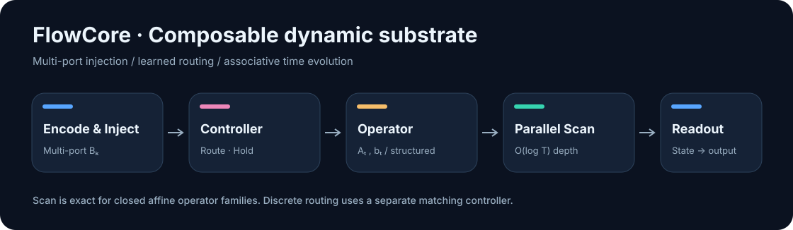
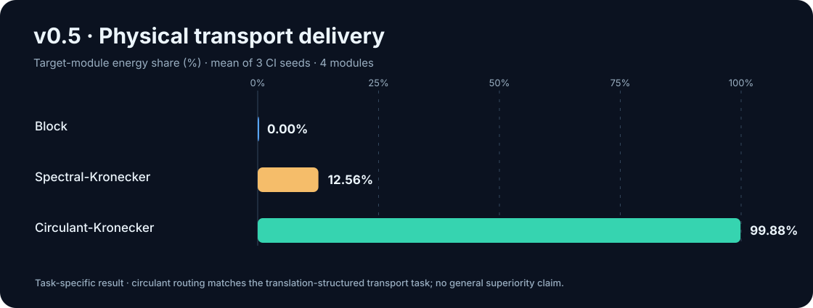
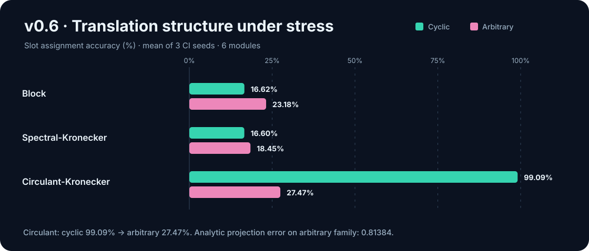
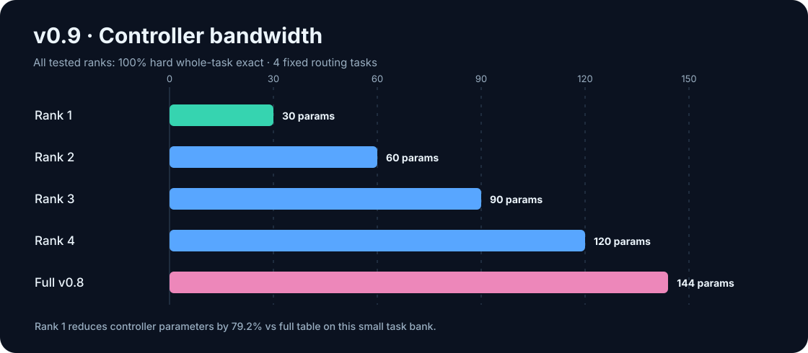
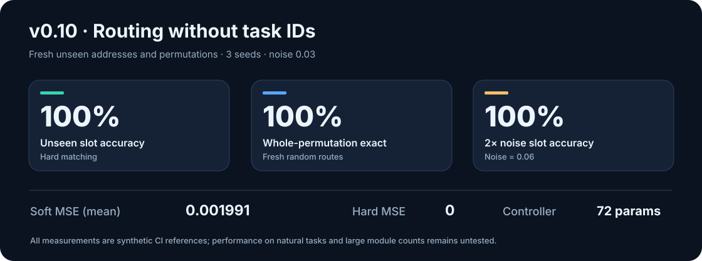

# FlowCore

[](https://github.com/ZJY-HSBL/Flowcore/actions/workflows/ci.yml)


**Composable discrete dynamics · Parallel prefix scan · Dynamic routing**

FlowCore is an experimental PyTorch research library for persistent-state
neural computation. It represents time evolution as structured, associative
transition operators, then evaluates them with a work-efficient parallel scan.
Route, Hold and multi-port injection provide configurable dynamic behavior.



> **Research status — v0.11.0.** The figures below are *real recorded CI reference
> measurements on synthetic tasks*, not fabricated projections. They do not
> establish AGI capabilities, generic sequence-model superiority, GPU speedups,
> or effectiveness on natural-language/vision tasks.

## The mathematical idea

For affine dynamics:

```text
h[t+1] = A[t] h[t] + b[t]

(A2, b2) ∘ (A1, b1) = (A2 A1, A2 b1 + b2)
```

Operator composition is associative. FlowCore implements a work-efficient
Blelloch scan with **O(T) operator compositions** and **O(log T) dependency
depth**. This is an algorithmic property, **not** an unconditional throughput
claim: operator composition can be more expensive than serial matvecs.

The project tests four substrate families: block-local affine, spectral-
Kronecker, circulant/FFT-Kronecker, and monomial permutation × gain. The first
three are selectable via `FlowCoreModel`; the monomial family is currently an
independent exact-scan primitive used with discrete controllers.

## Experiments and measured results

The charts use data from [`results/ci_reference_summary.json`](results/ci_reference_summary.json).
**Each version has a different controlled protocol**, so cross-version figures
must not be treated as a single matched leaderboard. Full protocols, limitations,
and links to the original CI runs are in [Experiment results](docs/RESULTS.md).

### v0.5 — Can information move between physical modules?



| Backend | Target-module energy | Long-horizon target MSE |
| :-- | --: | --: |
| Block-local | 0.00% | 0.97018 |
| Spectral-Kronecker | 12.56% | 0.55690 |
| **Circulant-Kronecker** | **99.88%** | **0.00320** |

Three seeds, 4 modules, 1D local state, fixed input source and trainable destination
Route policy with frozen substrate; [CI run and artifact](https://github.com/ZJY-HSBL/Flowcore/actions/runs/37742036277).
Circulant performs well on this *translation-aligned* task.

### v0.6 — Where does circulant routing fail?



| Backend | Cyclic slot accuracy | Arbitrary slot accuracy |
| :-- | --: | --: |
| Block-local | 16.62% | 23.18% |
| Spectral-Kronecker | 16.60% | 18.45% |
| **Circulant-Kronecker** | **99.09%** | **27.47%** |

Three seeds, 6 modules, 2D local state, simultaneous multi-source payloads;
[CI run](https://github.com/ZJY-HSBL/Flowcore/actions/runs/37797719671).
The **0.81384** normalized analytic projection error on the arbitrary family
shows a *representation limitation*, not only a training failure.

### v0.7–v0.9 — Exact arbitrary routing and controller compression

v0.7 added an associative **monomial operator** (one-to-one permutation × gain):
the supplied-permutation oracle achieved **zero MSE**, **100% slot accuracy**
and **zero parallel/sequential error**
([v0.7 CI](https://github.com/ZJY-HSBL/Flowcore/actions/runs/37798579002)).
v0.8 then learned all four fixed arbitrary permutations through Sinkhorn
relaxation and hard assignment from payload reconstruction loss
([v0.8 CI](https://github.com/ZJY-HSBL/Flowcore/actions/runs/37799900510)).



| Controller | Parameters | Hard whole-task exact |
| :-- | --: | --: |
| Rank 1 | **30** | **100%** |
| Rank 2 | 60 | 100% |
| Rank 3 | 90 | 100% |
| Rank 4 | 120 | 100% |
| v0.8 full task table | 144 | 100% |

v0.9: three seeds, four **fixed** 6-module tasks; [CI rank sweep](https://github.com/ZJY-HSBL/Flowcore/actions/runs/37800868426).
The 30-parameter result establishes compression **on this task bank only**; it
does not mean rank 1 can encode every possible permutation family.

### v0.10 — Learn routing from content, without task IDs



Each training/evaluation batch regenerates source descriptors and random
permutations. A shared **72-parameter** matching controller learns to align
source and target descriptors observed through two fixed but different views.

| v0.10 metric | Seed 0 | Seed 1 | Seed 2 | Mean |
| :-- | --: | --: | --: | --: |
| Soft Sinkhorn MSE | 0.001702 | 0.002464 | 0.001807 | **0.001991** |
| Hard execution MSE | 0 | 0 | 0 | **0** |
| Unseen permutation exact | 100% | 100% | 100% | **100%** |
| 2× noise slot accuracy | 100% | 100% | 100% | **100%** |
| Parallel/sequential error | 0 | 0 | 0 | **0** |

3 seeds, 6 modules, 3D payloads, 450 updates, context noise 0.03 (2× = 0.06),
512 evaluation samples per seed; [v0.10 CI + JSON artifact](https://github.com/ZJY-HSBL/Flowcore/actions/runs/37801859799).
All **39 tests passed** on Python 3.10, 3.11 and 3.12. These measurements
demonstrate *synthetic content-conditioned matching*, not novel semantic
reasoning. The two views remain fixed within each training run.

## Installation and quick start

```bash
git clone https://github.com/ZJY-HSBL/Flowcore.git
cd Flowcore
python -m pip install -e ".[dev]"
pytest -q
python examples/toy_delayed_copy.py
```

```python
import torch
from flowcore import FlowConfig, FlowCoreModel

config = FlowConfig(
    input_dim=16, output_dim=4,
    state_dim=256, block_size=8,
    num_ports=8, active_ports=2, context_dim=32,
    substrate_kind="circulant_kronecker",  # or "block", "spectral_kronecker"
)
model = FlowCoreModel(config)

x = torch.randn(8, 128, 16)
context = torch.randn(8, 32)
parallel = model(x, context=context, mode="parallel")
sequential = model(x, context=context, mode="sequential")
print(parallel.output.shape)                          # (8, 128, 4)
print((parallel.states - sequential.states).abs().max().item())
```

## Reproduce the figures

The curated CI data are checked into
[`results/ci_reference_summary.json`](results/ci_reference_summary.json).
These are **recorded reference numbers**, not a substitution for running the
experiments yourself. Representative commands:

```bash
python experiments/compare_substrates.py --steps 120 --seeds 0,1,2 --modules 4 --local-dim 1 --train-time 4 --long-time 16
python experiments/arbitrary_routing_stress.py --steps 100 --seeds 0,1,2 --modules 6 --local-dim 2 --tasks 4 --long-time 16
python experiments/factorized_controller_sweep.py --steps 300 --seeds 0,1,2 --ranks 1,2,3,4
python experiments/context_route_generalization.py --steps 450 --seeds 0,1,2 --modules 6 --context-dim 6 --rank 6
```

For **exact CI command flags** (including batch sizes, evaluation settings and
output paths), see [`docs/RESULTS.md`](docs/RESULTS.md) and
[`.github/workflows/ci.yml`](.github/workflows/ci.yml).

## v0.11 — Testing unseen observation views

The next experiment deliberately changes the orthogonal observation views at
evaluation. It compares the **v0.10 learned fixed-view controller** with a
**zero-parameter distance-fingerprint matcher** whose features are invariant to
orthogonal transformations. Noise is swept across 0.03, 0.06, 0.12 and 0.20.
The invariant route is an analytical baseline, not learned semantic reasoning.

```bash
python experiments/unseen_view_stress.py --steps 400 --seeds 0,1,2
```

See [the v0.11 protocol](docs/V0_11_REPORT.md) for the precise distinction
between trained and unseen views.

## Scope and next research questions

The mathematical kernel and toy experiments are functional. However:

- Monomial routing is not yet integrated as a drop-in `FlowCoreModel` backend.
- Exact hard assignment uses a small-M exponential-time reference solver;
  learned matching still constructs an O(M²) score matrix.
- Continuous Hold interpolation is not generally closed in the monomial family.
- Synthetic address matching with fixed view transforms does not establish
  unseen-view or real-world generalization.
- Short T=16 CPU measurements in v0.5 favored **sequential** execution. Actual
  GPU end-to-end speedups and true sparse kernels remain unverified.

Next priorities: unseen observation transforms, module-count/noise scaling,
efficient permutation selection, Hold-compatible composable operators,
and high-dimensional sequence benchmarks.

**Documentation:** [Architecture](docs/ARCHITECTURE.md) ·
[Roadmap](docs/ROADMAP.md) ·
[Experiments and provenance](docs/RESULTS.md) ·
[v0.10 report](docs/V0_10_REPORT.md) ·
[MIT License](LICENSE)
